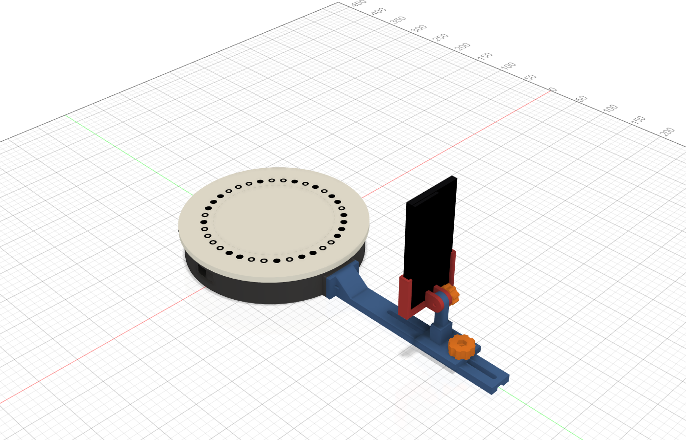
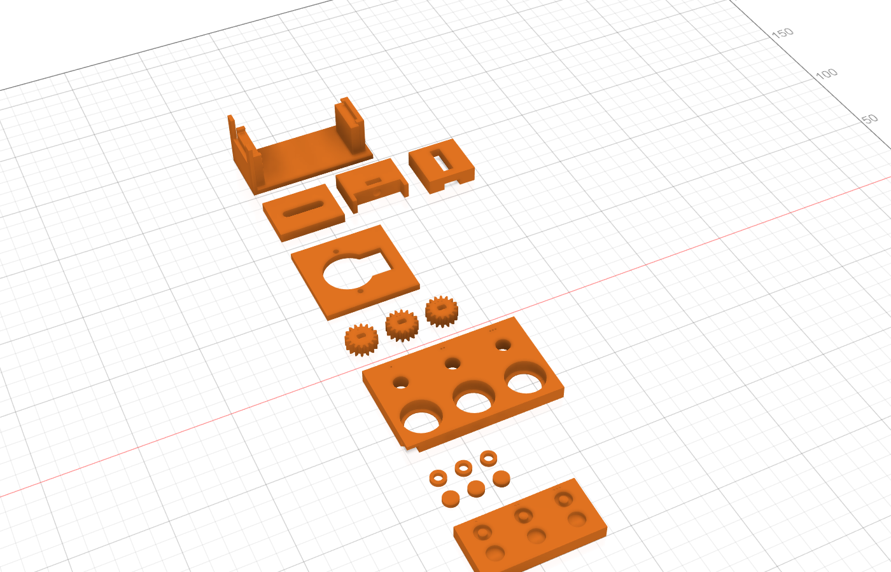
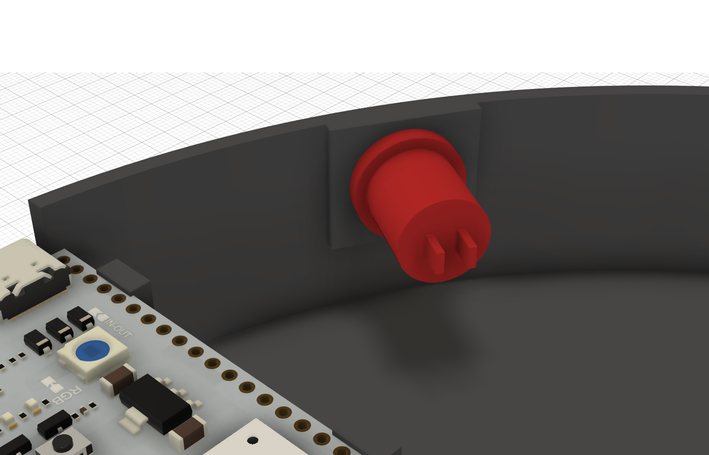
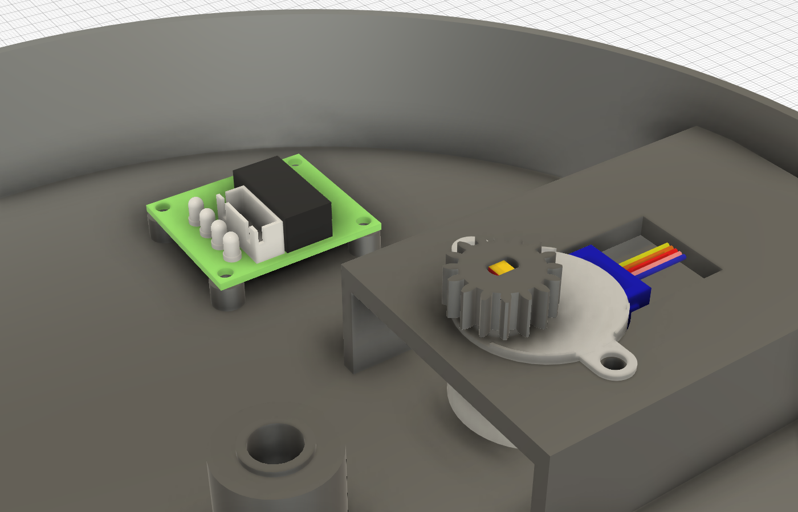
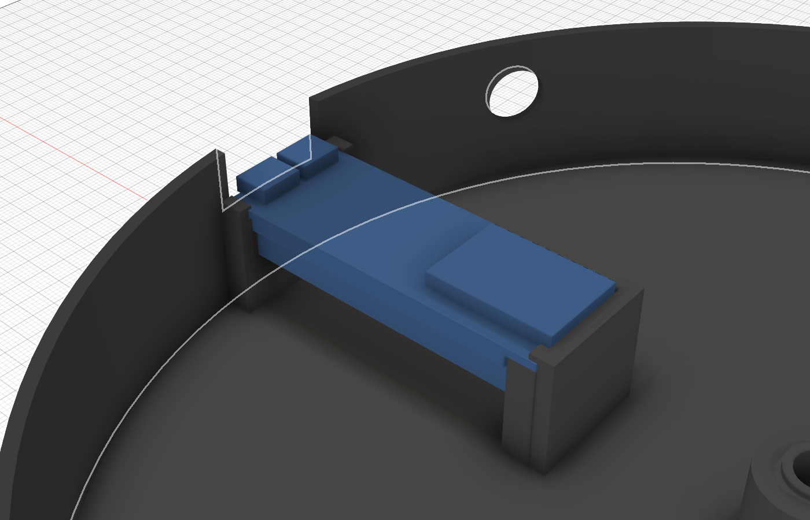
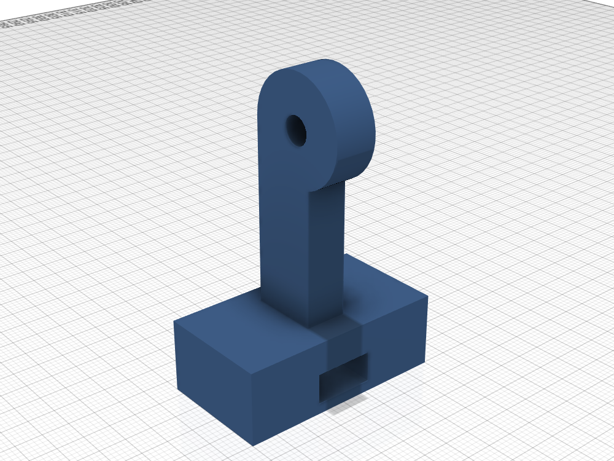
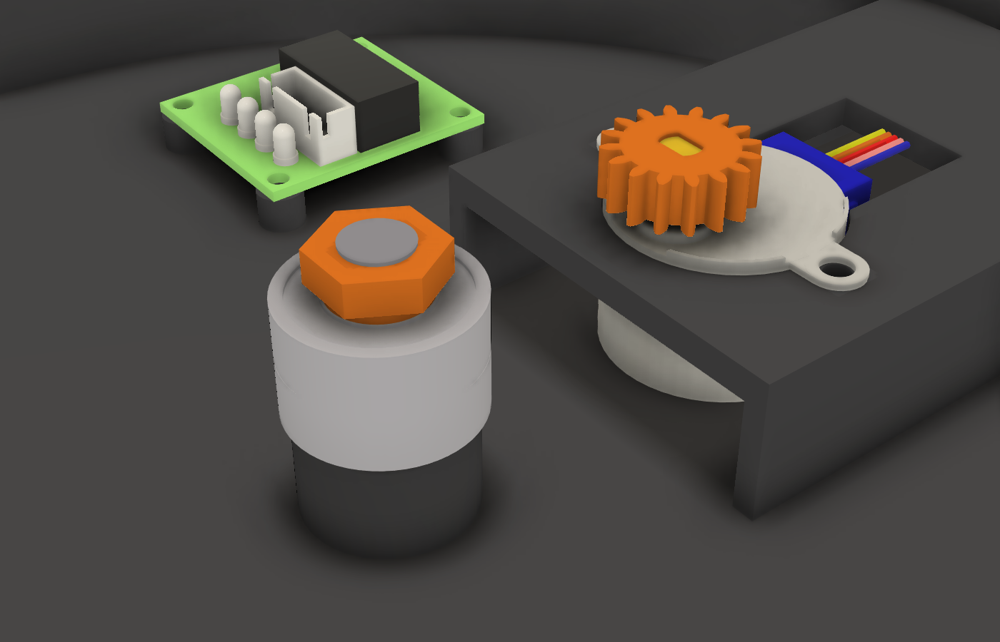

# Motorised turntable

A Ø240 mm platter with the printed-mat dots as black inserts, turned by a 28BYJ-48 through a 16:64 gear pair, with an
ESP32-S3 and the ULN2003 board in the base, and a tilting phone stand on a slotted arm with an adjustable cradle: any
phone about 50–105 mm wide and up to 18 mm thick, case included (iPhone 13 Pro, Galaxy S24 Ultra, a rugged case).

Everything is generated by [turntable_fusion.py](turntable_fusion.py): run it in Fusion on an empty design
(Utilities > Scripts and Add-Ins). It builds every part as its own component, with reference models (`RIF ...`): the
28BYJ-48 and the ULN2003 board imported from [models/](models), the two 608ZZ and the M8 axle bolt, a phone, and the real ESP32 board inserted from the
Fusion project and the test pieces (`Prova ...`) beside it; export the meshes from Fusion. Change
the parameters at the top of the script (platter size, phone dimensions, camera distance, clearances) and run it again.

## Test prints first

Print the `Prova ...` components before the long parts: about an hour, and they set the fits on your printer. Each ladder
has three steps marked with 1, 2 and 3 dimples; put the step that fits into the parameter, run the script again and
print the real parts.

| Component | What to check | Steps (1 / 2 / 3) | Parameter |
|---|---|---|---|
| Prova piatto + Prova inserti | inserts pressed into the platter's pockets: firm by hand, flush, not cracking | 0.10 / 0.15 / 0.20 mm radial clearance (dimples under each insert) | `INSERT_CLEAR` |
| Prova cuscinetti, top row | a 608ZZ pressed in by hand or with a vice, not loose | Ø 22.00 / 22.15 / 22.30 | `BEARING_OD` |
| Prova cuscinetti, bottom row | the M8 bolt's head pressed into the hex from below, not turning | 13.0 / 13.2 / 13.4 across flats | `AXLE_HEAD_AF` |
| Prova pignoni | pinion on the motor shaft: snug, no wobble, no cracking | bore Ø 5.0 / 5.1 / 5.2, flats 3.0 / 3.1 / 3.2 | `SHAFT_BORE` |
| Prova motore | the 28BYJ-48 drops through, its blue housing in the notch, M3 screws in the ears | one size (Ø 28.8) | `MOTOR_BODY_HOLE` |
| Prova asole | the jaw slice slides along the plate piece, its C over both edges, without wobbling; the M5 head sits in the jaw; the M6 head slides in the arm's channel and the bolt in its slot | one size each | `PLATE_CLEAR` |
| Prova ULN2003 | the board's four holes on the standoffs, M3 self-tapping screws biting | 30.2 × 26.4 mm hole spacing, the model's | `ULN_HOLES`, `ULN_PILOT` |
| Prova ESP32 | the board presses down past the four lips onto the ribs, its far end against the stop, and does not move when you plug and pull the cable | one size | `ESP_L`, `ESP_W` |

Print them like the real parts: platter, bearing and motor pieces flat; the jaw piece is already lying on its outer
face. Also try the M5 and M6 nuts in one Pomello M5 and Pomello M6, which you need anyway.

## Printed parts

| Component | Colour | How to print |
|---|---|---|
| Piatto | white, matte | top face on the bed: the gear comes out on top, no supports |
| Inserti pieni (18), Inserti anello (18) | black | flat; press into the pockets, a drop of glue if loose |
| Base | any | as modelled, no supports |
| Pignone | any | flat, fine layers (0.12 mm) |
| Braccio | any | bar on the bed |
| Torre | any | foot on the bed |
| Supporto piastra | any | front face on the bed: hinge ears up, no supports |
| Ganascia sinistra, Ganascia destra | any | outer face on the bed, so the V groove prints without supports |
| Pomello M6, Pomello M5 | any | nut pocket up; press the nut in |
| Pomelli ganasce (2) | any | the M5 knob again, one per jaw |
| Dado asse | any | collar down, 100 % infill: the M8 bolt cuts its thread in it |
| Attacco treppiede | any | block on the bed, nut slot on the side, no supports (optional, see below) |

The dots sit exactly where the paper mat has them (ring Ø176, dots Ø9, holes Ø4.5) and the same way round seen from
above, so the mat code reads the same. The white centre of a ring dot is a post of the platter; the dashed groove
marks where the piece must stand. Insert fit is `INSERT_CLEAR` (0.15 mm radial).

## Bill of materials

### To buy

| Qty | Item | Where it goes | Bought (price paid per pack) |
|---|---|---|---|
| 1 | 28BYJ-48 stepper motor, 5 V | hangs from the motor plate in the base | [Aihasd, Amazon.it](https://www.amazon.it/dp/B00U744GJU): €9.99 for 3 motors + 3 ULN2003 boards (Jan 2026) |
| 1 | ULN2003 driver board (35 × 31.5 mm, holes 30.2 × 26.4) | on four standoffs in the base | in the motor pack above |
| 1 | ESP32-S3-WROOM-1 devkit, 2 × USB-C (57 × 28.3 mm), headers soldered pins down | in its holder in the base | [Binghe S3-DevKitC-1 N16R8, Amazon.it](https://www.amazon.it/dp/B0D6B2CYNW): €24.99 for 3 (Jun 2026) |
| 2 | 608ZZ bearing (8 × 22 × 7) | pressed into the platter's hub | [YAPKOLV, Amazon.it](https://www.amazon.it/dp/B0F6LHYSS8): €7.49 for 12 (Apr 2026) |
| 1 | M8 × 30 hex bolt | the axle, head pressed into the hex under the base |  |
| 2 | M3 × 8 screw + M3 nut | motor ears to the plate |  |
| 4 | M3 × 6 self-tapping screw | ULN2003 board to its standoffs |  |
| 2 | M4 × 16 screw + M4 nut | arm to the base (nuts in the pockets inside the base) |  |
| 1 | M6 × 25 hex bolt + M6 nut | tower to the arm (head in the arm's channel, nut in the M6 knob) |  |
| 1 | M5 × 35 screw + M5 nut | tilt axis (nut in the M5 knob) |  |
| 2 | M5 × 20 hex bolt + M5 nut | jaws (head in the jaw, nut in the jaw knob) |  |
| 1 | 12 mm momentary panel button (normally open, wall up to ~5 mm) | start/stop through the base wall, nut on the flat seat inside |  |
| 1 | 1/4"-20 hex nut (7/16" across flats) | tripod adapter (optional) |  |
| ~8 | Dupont female–female jumper wires | ESP32 to ULN2003 (IN1–IN4, 5 V, GND) and the button |  |
| 1 | USB-C cable and 5 V USB supply | powers everything through the ESP32 |  |

### To print

PLA or PETG. Volumes are of the solid parts as modelled; with the usual walls and infill the slicer will use less.

| Component | Qty | Colour | Volume (cm³) | Solid PLA (g) |
|---|---|---|---|---|
| Piatto | 1 | white, matte | 383.5 | 476 |
| Inserti pieni, Inserti anello | 18 + 18 | black | 4.4 | 5 |
| Base | 1 | any | 225.7 | 280 |
| Pignone | 1 | any | 1.1 | 1 |
| Braccio | 1 | any | 74.7 | 93 |
| Torre | 1 | any | 39.3 | 49 |
| Supporto piastra | 1 | any | 24.5 | 30 |
| Ganascia sinistra, Ganascia destra | 1 + 1 | any | 27.6 | 34 |
| Pomello M6 | 1 | any | 6.9 | 9 |
| Pomello M5 + Pomelli ganasce | 1 + 2 | any | 10.3 | 13 |
| Attacco treppiede (optional) | 1 | any | 16.1 | 20 |
| **Turntable and stand** | | | **815** | **≈ 1010** |
| Test prints (`Prova ...`, all eight) | | any | 100 | 124 |

## Wiring

| ESP32-S3 | ULN2003 / button |
|---|---|
| GPIO 4, 5, 6, 7 | IN1, IN2, IN3, IN4 |
| 5V | + (leave the jumper on) |
| GND | − |
| GPIO 15 / GND | button (internal pull-up) |

The motor plugs into the board's white connector. Power comes from the ESP32's USB-C.

## Start/stop button

To run the platter without the app (no Bluetooth or serial), a 12 mm momentary panel button goes through the base
wall at 150°, beside the ESP32, 22 mm up: under the platter's rim but within reach from the side. Inside the wall a
flat seat (4.5 mm thick at the hole) takes its nut. Its two tags go to GPIO 15 and GND (see Wiring); the firmware
starts or stops the platter on a short press, with a ramp, and reverses it on a long press. Move it with
`BUTTON_ANGLE` and `BUTTON_Z`.

## Motor and driver

Both are fitted to the models in [models/](models) (from [escornabot/3dmodel](https://github.com/escornabot/3dmodel),
MIT, see `LICENSE-escornabot`). The 28BYJ-48 hangs from the motor plate with its ears on it, its body 0.5 mm above the floor (M3 screws 35 mm
apart); its blue cover and wire exit reach 30 mm from the body's centre, and the plate's notch runs to 31 mm. The
pinion's double-D bore is turned to the shaft's flats as the model has them (facing the body's centre), and the
pinion sits only on the 6 mm of flats (29.7–36 mm above the table). The ULN2003
board (35.1 × 31.5 mm, holes 30.2 × 26.4 mm apart) stands on four 5 mm standoffs beside the motor mount. Boards vary:
check the hole spacing on `Prova ULN2003` before printing the base.

## ESP32 holder

The holder is fitted to the real board's model (`ESP32-S3-WROOM-1_devkit_2xUSBC` in the Scan3DTable Fusion project,
inserted in the design by the script): PCB 57 × 28.3 × 1.5 mm, pin rows 25.4 mm apart along almost all of its length,
the WROOM module overhanging the far end by 6.4 mm, two USB-C at the near end.

The board sits pins down, 21 mm above the floor so the Dupont plugs fit under it. It rests on two ribs between the
pin rows, its far end against a stop that stays under the module's overhang, and four snap lips over its long edges
(outside the pins' solder joints) hold it down: press it in from above. Its USB-C ports face a 25 mm opening in the
wall, open at the top and narrower than the board: plugging in pushes the board against the stop, pulling out pulls
it against the wall beside the opening. Checked on the model: nothing touches it in place, and 0.2–0.5 mm of play in
any direction brings the PCB, never a component, against the holder. The platter's rim covers the opening.

## On a tripod

To shoot from further away or from another height, the cradle can leave the tower for any camera tripod. Print the
`Attacco treppiede`: a block with a 1/4"-20 nut slid in from the side (the standard tripod screw goes in from below)
and the same 8 mm tab and M5 hole as the top of the tower. Take the M5 knob off the tower, move the cradle with its
jaws onto the adapter, put the bolt and knob back: the tilt works as on the tower, clear from 25° back to 60° forward
with all three reference phones. The tilt axis is 35 mm above the block, so the tripod's own head is not needed.

## Firmware

[firmware/](firmware) is a PlatformIO project on the latest stable pioarduino platform (Arduino core 3.x) for the
ESP32-S3-DevKitC-1. Open the folder in the pioarduino IDE and use Upload, or from that folder run
`~/.pioarduino/penv/Scripts/pio run -t upload` and then `... pio device monitor` (with `PLATFORMIO_CORE_DIR` set to
`~/.pioarduino`). Use the board's UART ("COM") USB-C port, both to flash and for the serial commands.

- Button: a short press starts or stops (with a ramp), a long press reverses. The RGB LED is green or blue while
  turning, by direction.
- Commands, one per line, over USB serial at 115200 or over Bluetooth LE: `run`, `stop`, `speed <seconds per turn>`
  (20–600, default 40, also while turning), `accel <deg/s²>` (the ramps, 1–100, default 13), `dir <1|-1>`,
  `reverse`, `turn <degrees>`, `goto <degrees> [1|-1]` (the shorter way, or in the given direction), `zero`,
  `status`. `turn` and `goto` print `done ...` when they get there. Replies start with `ok`, `err` or `done`, button
  presses send an `event` line; every line carries `state=`, `dir=`, `speed=`, `accel=` and `angle=`.
- Bluetooth LE: the board advertises as `Scan3D Turntable` with the Nordic UART Service (`6E400001-B5A3-F393-E0A9-E50E24DCCA9E`).
  Write commands to RX (`6E400002-...`); replies are notified on TX (`6E400003-...`) in pieces of up to 20 bytes, so
  join them and split on `\n`. Any BLE UART app (nRF Connect, Serial Bluetooth Terminal) can drive it.
- The coils are switched off when stopped; the gearbox holds the platter.
- Steps are counted with the 28BYJ-48's real gearbox ratio (63.684:1), so `turn` and the reported angle are right
  over many turns. The scan itself does not depend on them: the app takes the pose from the dots.

## Geometry

- The axle: the M8 × 30 bolt's head sits in the hex under the base, its shank goes up through the central boss;
  the two 608ZZ slide onto it, their inner races on the boss's 11.5 mm ring. On top goes the printed `Dado asse`, a thin
  nut (4 mm, Ø 7 mm bore: the bolt cuts its own thread) with a 1.5 mm collar underneath that bears on the inner race
  only, clear of the ZZ shields. Screwed down, it clamps both inner races onto the ring and pulls the bolt's head up
  into its hex, so neither the bearings nor the bolt can move. The bearings sit 1.5 mm below the hub's lip so the
  bolt comes right through the nut. Then the platter's hub is pressed down over the outer races; it rests on the upper one and
  lifts off again.

  

- Base 30.9 mm tall, platter 8 mm thick with its top 40.9 mm above the table: the heights follow from the motor (body just above the 2.4 mm floor, pinion on the shaft's flats, platter 1 mm above the pinion). The only hole in the bottom is the hex for the axle bolt's head. The platter sits on the upper bearing's outer race and lifts off.
- Gear module 1, 64 teeth on the platter, 16 on the pinion, centre distance 40.1 mm: 4 motor turns per platter turn,
  about 16303 half steps per platter turn (the motor's gearbox is 63.684:1, not 64).
- Phone stand: the tower's foot has skirts down both sides of the arm, so it slides along it and cannot turn round
  its bolt while you tighten the knob; the phone's face can be about 130–290 mm from the platter centre
  (250 mm as modelled, for TrueDepth). The tilt axis is 70 mm above the table; the cradle tilts from 15° back to 55°
  forward without touching the tower, checked with all three reference phones.
- The cradle holds the phone by its long edges, standing on the two jaws' feet, both faces free: screen towards the
  platter for the front camera (TrueDepth on the iPhone), back towards it for the rear cameras (and the iPhone's
  LiDAR). Each jaw's back is a C that rides on the plate's top and bottom edges (0.2 mm clearance) and runs on 14 mm
  past the jaw, so it slides along the plate and turns less than 1° round its bolt; the knobs behind the plate clamp
  it. Their V grooves (20 mm open, 4 mm deep) centre the phone whatever its thickness, so the camera stays over the same point. The bottom middle is
  free for the charging cable. The reference phones are in `PHONES` at the top of the script.
